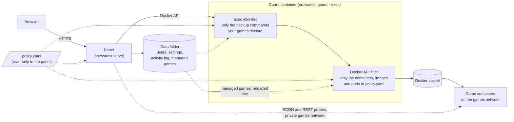
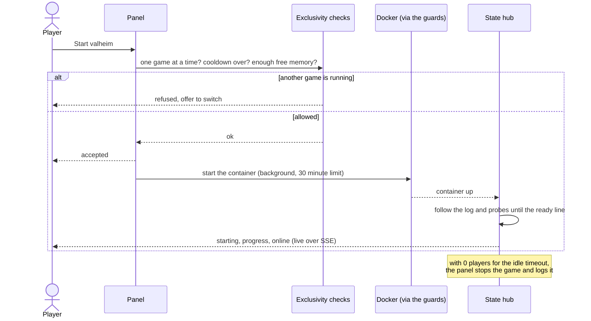
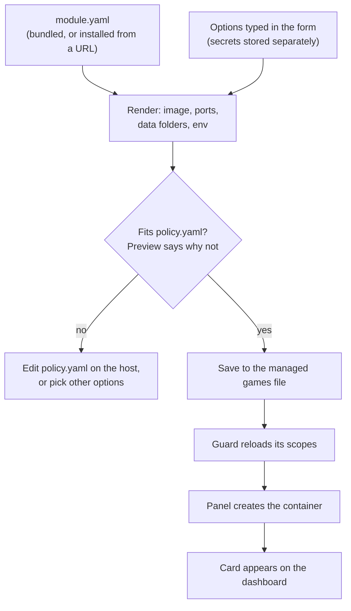

# CrowsNest

A self-hosted web dashboard for starting, stopping and watching game server containers on a home server. It shows
live status, logs, player counts and resource use, keeps one game running at a time by default, and stops a game on
its own when nobody has been on for a while.

## Why this exists

CrowsNest is a side project. It started with a Valheim server, then a Windrose server, then a Palworld server, all
for me and a friend we play with. I didn't want them running around the clock on my homelab machine, using memory
and CPU while nobody was playing.

So either of us can start a server when we want to play, play for as long as we like, and then stop it, or let it
stop itself after a set time with nobody on. The resources come back.

It's built for that: a few friends sharing one box, not a hosting business. If that sounds like your setup, it may
be useful to you too. The licence is noncommercial (see [License](#license)).

## How it fits together

The panel never gets the raw Docker socket in the recommended setup. Every Docker call goes through a guard that
ships in the same binary, so a bug in the web app can't turn into control of the whole host. The guard is its own
container, and the panel is the only other one.



The panel can read the policy but can't change what the guard enforces. If someone gets into the panel, they can
still only do what `policy.yaml` allows.

### What happens when someone presses Start



Start returns as soon as the checks pass. The pull and create happen in the background, so a closed tab or a proxy
timeout doesn't kill an image download partway through.

### Adding a game from the dashboard

Games added from the Games page are described by a module (one YAML file) and checked against the policy before
anything is created.



## Status

I run this myself, with Valheim, Windrose and Palworld. The login, dashboard, start, stop and switch,
live logs, startup progress, player counts, idle and overnight auto-stop, Discord notifications, the Games page and
memory checks are built and have tests. The Docker guards have their own tests too.

What I haven't verified against real servers yet:

- the Windrose log lines that mark a graceful quit;
- Valheim player joins and leaves on a live server;
- a full Start then Switch between two real games.

The Minecraft, Source and Don't Starve Together modules were written and tested against sample logs, not against
servers I run. Treat them as a starting point. The quickstart stack hasn't been run end to end on a clean machine
either, though its config and policy are checked by a test. [`docs/implementation-plan.md`](docs/implementation-plan.md)
has the history and the open items, and [`roadmap.md`](roadmap.md) has what's next.

## Games

| Module | Game | Status and players come from |
|---|---|---|
| `valheim` | Valheim (`lloesche/valheim-server`) | the container log |
| `palworld` | Palworld (`thijsvanloef/palworld-server-docker`) | its REST API |
| `windrose` | Windrose (`indifferentbroccoli/windrose-server-docker`) | the container log; richer info if the optional Windrose+ integration is on |
| `minecraft` | Minecraft (`itzg/minecraft-server`) | the container log |
| `source` | TF2, CS2, L4D2 and other Source-engine games | RCON |
| `dontstarve` | Don't Starve Together | the container log |

Every game's setup is in [docs/modules.md](docs/modules.md). How players actually reach a server (Tailscale, invite
codes, and why an HTTP tunnel can't carry game traffic) is in [docs/connecting.md](docs/connecting.md).

### Adding your own game

A game is one `module.yaml` file and no code. [docs/writing-modules.md](docs/writing-modules.md) walks through
writing one, checking it with `crowsnest module check` against a captured log before you run the game, installing it
(by hand or from a URL, with the download pinned to a hash), and sharing it. CrowsNest doesn't need to know about
your module for it to work.

Community-style modules that are not bundled live in [fiddler110/crowsnest-modules](https://github.com/fiddler110/crowsnest-modules): one folder per module, each signed, with a README
that covers everything a module needs, scripts to check, sign and install them, and a template to start from. Its
signing key for `managed.trusted_keys` is in that README.

## Running it

Images are published to `ghcr.io/fiddler110/crowsnest` (`:latest`, `:X.Y.Z`, `:X.Y`, `:dev`). Every push to `main`
passes the CI and security gate before a release is cut. Images are scanned, signed with cosign and shipped with an
SBOM; see [docs/publishing.md](docs/publishing.md). You don't need a Go toolchain.

**The fastest start** is [`quickstart/`](quickstart/README.md): the panel plus the guard, with no games
configured. You add games from the web page. At any point,
`docker compose exec crowsnest crowsnest doctor` checks Docker access, file permissions, the policy and a few safety
settings, and tells you what to fix.

The steps below are the longer, hand-configured setup, where games are defined in `config.yaml` and a compose file.

1. Copy [`config.yaml.example`](config.yaml.example) to `config.yaml`, [`compose.yaml.example`](compose.yaml.example)
   to `compose.yaml` and [`.env.example`](.env.example) to `.env`, and edit them. `config.yaml` holds paths,
   timezone and integrations, `compose.yaml` holds volumes and ports, and `.env` holds secrets and host-specific
   values (it's git-ignored).

   CrowsNest runs `docker compose` against that same compose file from inside its own container (mounted at
   `/data/compose.yaml`, with `.env` next to it as `/data/.env`). So keep the top-level `name:`, use absolute
   `${USERDIR}/...` host paths in game services, and don't use `${VAR:?}` there: compose interpolates the whole
   file, so one missing variable for one game would block every game from starting. The header of
   `compose.yaml.example` explains each point.
2. Start only the controller: `docker compose up -d crowsnest`. It starts and stops the game containers itself, so
   you never run `--profile <game> up` by hand.
3. Open `http://<host>:5000`. With no users yet you get the first-run setup page. Read the setup code from
   `docker compose logs crowsnest` (it's also saved as `setup-token` next to the session secret), then choose an
   admin username and passphrase. The page closes once the first account exists, and there are no default
   credentials. If you'd rather use the command line,
   `docker compose exec crowsnest crowsnest set-password <username>` works too.

### One server at a time

The dashboard shows a card for every game, and any of them can be started or stopped from it. By default only one
game may run at once. Pressing Start on a second game is refused, and the dashboard offers to switch instead: stop
the running game, wait for it to go offline, then start the new one.

To allow more than one at a time, set `CROWSNEST_MAX_ACTIVE_GAMES` in `.env` or `server.max_active_games` in
`config.yaml` (the environment variable wins). When the limit is reached, Start still offers to switch away from
the first running game.

Palworld has a 30 second pause between a stop and the next start, because bringing it back up within seconds
crashed the server.

### Memory

Before a start, CrowsNest compares what the game needs with the host's available memory, minus a reserve
(`server.memory_reserve_mb`, 1024 by default, negative turns the check off). A game's need is its measured peak once
it has run, and the module's `runtime.ram` figure before that (an option on the game can override it). If it
doesn't fit, the start is refused with a message that says so. If the need or the host's memory isn't known, the
start is allowed.

With the default of one game at a time this rarely matters. It starts to matter once you raise
`max_active_games`.

### Starting is asynchronous

Start (and the start half of Switch) returns as soon as the limit, cooldown and memory checks pass. The
`docker compose up` itself, which includes pulling a multi-GB image the first time, runs in the background with a
30 minute limit. While it runs the game shows as **starting**, counts toward the limit, and its progress bar reads
"Pulling image / creating container" until the container exists. A failed start shows up as a toast on the
dashboard and as an `exclusivity: start ... failed` line in the log. Stop cancels a start that's still running.

With a compose file configured, Start always runs `compose up -d`, so edits to the compose file or `.env` take
effect on the next start (compose recreates the container). Behind a Docker API proxy that denies container delete
and rename, that recreate fails. Run `docker rm <game>` on the host, then Start again.

### Automatic shutdown and settings

By default a game with zero players for 15 minutes is stopped. It stays stopped until someone starts it again. A
game whose player count can't be read is never stopped automatically. An optional overnight window
(`night_shutdown`) stops empty servers during set hours.

Any signed-in user can change these from **Settings** on the dashboard, and the change applies immediately:

| Setting | Meaning |
|---|---|
| Stop a server when nobody is on it / minutes | the idle auto-stop and its timeout (1 to 1440 minutes) |
| Stop empty servers overnight / from / until | the overnight window, in `server.tz` hours |
| Servers allowed at once | how many games may run together |
| Per game: idle minutes / restart wait / overnight shutdown | override the idle timeout, the pause required between stopping and restarting, and whether the game is included in the overnight stop, for one game; an empty box uses the global value or the module's default |
| Update on start | run `docker compose pull` for the game each time it starts, so a restart picks up new server versions (a failed pull is logged and the old image is used) |

`config.yaml` holds the defaults. Whatever is saved from the dashboard is written to `server.settings_file`
(default `/app/data/settings.json`) and takes precedence from then on. Mount a directory there so it survives
container recreation (`${USERDIR}/crowsnest/config:/app/data` in `compose.yaml.example`; it must be writable by uid
1000). Delete the file to go back to the `config.yaml` values.

### Users and roles

There are two roles. An **admin** can do everything. A **player** can start, stop and switch games and see status,
players, stats and activity, but can't open Settings or the Games page, read container logs, use the console or
touch backups.

Admins manage users on the **Users** tab in Settings. From the command line,
`docker compose exec crowsnest crowsnest set-role <user> <admin|player>` does the same. A password account with no
role is an admin, so accounts from before roles existed behave as they did. A Google sign-in user with no role is a
player, so promote yourself with `crowsnest set-role <you> admin` before relying on Google sign-in (CrowsNest logs a
warning at startup when no user resolves to admin). Role changes apply within seconds, and a demotion applies on the
user's very next request.

### Activity log, playtime and host health

Everything notable is appended to `server.history_file` (default `/app/data/events.jsonl`, one JSON object per
line): who started, stopped or switched a game, automatic stops, failed starts, settings changes, backups, and
players joining and leaving. The dashboard's logbook shows the latest entries and the total time each player has
spent in each game. That comes from join and leave events, so it only covers games whose player names CrowsNest can
read. Entries older than `server.history_retention_days` (default 180) are pruned. Keep the file on the same
persistent mount as the settings file.

Settings has an **Audit log** pane (admins) that filters the same log by game, kind, user, text and date.

**Crash loops.** Every 30 seconds CrowsNest reads each game container's last exit from Docker. A run that ended with
an exit code other than 0 or 143 (a normal stop) counts as a crash; 137 counts only when Docker says the kernel
killed it for memory, because `docker stop` produces 137 too when a game outlasts its grace period. Each crash is
logged. A game that crashes `crash_loop.crashes` times (default 3) within `crash_loop.window_minutes` (default 15) is
reported once as a crash loop, in the log and in Discord when a webhook is set, and again only after it has gone a
full window below the threshold. Crashes from before CrowsNest started are not counted.

**Metrics.** Set `server.metrics_token_env` to the name of an environment variable holding a token, and
`GET /metrics` serves Prometheus metrics (game up/players/crashes/crash-looping, host memory, load and disk) to a
scraper sending `Authorization: Bearer <token>`. With no token the route does not exist. It is outside the login
session, so if the panel is reachable from the internet, treat the token like a password.

A strip under the fleet banner shows host memory, load and free disk space for the paths in
`server.host_disk_paths`, and turns red when a disk is under 10% free or memory is nearly full. Mount the disk your
game data and images live on (read-only is fine) and list its path to watch it.

### Backups

A game with a `backup:` block in `config.yaml` (or in its module) gets a Backups panel for admins, with a "Back up
now" button and the list of backup files. Backups run inside the game's container with `docker exec`, so they use
whatever the image provides (the Palworld example in `config.yaml.example` shows one).

`exec` needs the Docker proxy to allow it, and a generic proxy can't limit which commands run. That's what the
bundled exec guard is for. It runs inside the guard container with `crowsnest guard --exec` (the quickstart does
this), or on its own as `crowsnest execguard` (the `execguard` service in `compose.yaml.example`). It allows
exactly the commands your config implies (each `backup.exec`, the `list_dir` listing, Windrose's readiness check),
refuses exec options such as `Privileged`, `User` and `Env`, and only lets `exec/<id>/start` through for ids it
approved itself. Restart it after changing `backup:` settings.

For the Docker API itself, `crowsnest guard` replaces the generic socket proxy. It's a scoped filter that lets
CrowsNest see and control only the containers named in `GUARD_SCOPES` (or the policy, for games added from the
dashboard).

With `before_stop: true` CrowsNest also takes a backup each time it stops that game on purpose, after the world is
saved, so an "update on start" pull always has a fresh backup behind it. A failed backup is logged and never stops
the game from stopping.

With `keep: N` (and `list_dir`) CrowsNest deletes all but the newest N files in `list_dir` after each successful
backup, using one more exec command the guard allows. It counts files, and the container needs `sh`, GNU `find`,
`sort`, `tail` and `cut`.

#### A shared backups folder

Set `platform.backups_root` (a host path, for example an external drive) and every dashboard-enabled game whose
module declares `backup.dir` backs up into its own folder, `<backups_root>/<game id>`. The panel mounts the folder
read-write at `platform.backups_mount` (default `/game-backups`), each game container gets only its own sub-folder,
and the panel lists and prunes it directly, with no `docker exec` for either. Add `backups_root` to `policy.yaml`
(the same path, separate from `games_root`) so the guard allows the bind. In the quickstart it is three commented
lines: the volume in `compose.yaml`, `backups_root` in `config.yaml`, and `backups_root` in `policy/policy.yaml`.

#### Offsite copy

The panel can delete everything in `backups_root`, so a copy that lives somewhere else is the real safety net.
`quickstart/offsite/` is a sidecar for that: the `rclone/rclone` image running `offsite.sh`, which copies
`backups_root` to any rclone remote (SFTP, S3, B2, Google Drive, another disk) every few hours.
CrowsNest does not run it, talk to it or hold its credentials; the remote's secrets live only in the sidecar's
own `rclone.conf`.

```sh
cd quickstart/offsite
cp rclone.conf.example rclone.conf && chmod 600 rclone.conf      # fill it in; see the comments in it
BACKUPS_ROOT=/mnt/usb/backups docker compose up -d                # the same path as platform.backups_root
docker compose exec crowsnest-offsite sh /offsite.sh check           # dry run: what would be copied
docker compose exec crowsnest-offsite sh /offsite.sh once            # one real copy; non-zero exit if it failed
```

What it does, and why:

- **Copy, never sync.** A backup the panel prunes (or you delete with a game) stays offsite. Set
  `OFFSITE_KEEP_DAYS` to age offsite files out on their own schedule; the default keeps everything.
- **`--immutable`.** A backup that changes after it was copied is an error, not an overwrite, so a damaged or
  tampered local file cannot replace a good offsite one. That run reports FAILED and the sidecar tries again next time.
- **It skips files younger than `OFFSITE_MIN_AGE`** (default 2 minutes), so a backup still being written is not copied half-done.
- **It refuses a folder without the `.crowsnest-backups` marker,** which is what an unmounted drive looks like,
  so it never reports success after copying nothing.
- **It runs read-only, with no capabilities, as uid 1000,** and mounts the backups folder `:ro`. The user must be
  able to read the backups (see Permissions above); change `user:` in `compose.yaml` if your games write them as someone else.
- **The dashboard shows the result.** The sidecar writes `status/offsite.json` after every run. Mount that folder
  read-only into the panel and set `platform.offsite_status_file` to the file's path there: admins then see a banner
  when the last copy failed or none has succeeded in over twice the interval, the health endpoint reports it, and
  Discord is told once when it breaks and once when it works again.
- For encrypted backups, wrap the remote in rclone's `crypt` remote (see the comments in `rclone.conf.example`).

Tested against a local folder and an SFTP server: new files copied on the next pass, a changed file refused, local
deletions leaving the offsite copy alone, `OFFSITE_KEEP_DAYS` removing only old files and empty folders, and the
unmounted-drive refusal. **Restoring from offsite** is a copy back: `rclone copy offsite:crowsnest/<game id>
<backups_root>/<game id>`, then use the Restore button as usual.

### Making a copy of a game (profiles)

**Games, Make a copy** on a game's card opens the add form filled in from that game's settings: a second Valheim
world, a friends' Palworld with another password. The copy is a game of its own (its own id, data folder, backups
folder, ports and start/stop), so it is edited, backed up, restored and disabled like any other. Its data folder is
left empty so it follows the new id, and its ports move to the next free ones the policy allows. **Secrets are
copied by the server and never shown**: leave a password field empty to keep the original's, or type a new one.
Games still start one at a time unless you raised "Servers allowed at once" and the memory budget allows it.

### Installing a module from a source

If `managed.trusted_keys` lists at least one publisher key in `config.yaml` (and `modules_dir` is set and writable by
the panel), the Games page has **Game modules from a source**: give it the https address of a `module.yaml`. The
panel fetches the module and the signature beside it (`<address>.sig`), checks that a key you trust signed those exact
bytes, and shows what the module would let it do. You confirm with your password and the install is of exactly the
file you were shown (a changed file is refused). Only signed modules can be installed this way. **Check for update**
beside an installed module fetches its recorded source again (never an address from the browser), shows what the new
file adds and removes, and replaces it after your password. The new file must be signed by a trusted key and declare
the same id. Games already using the module keep their current wiring until you save their settings or restart them.
Installing grants nothing: a game from the
module still has to fit `policy.yaml`. The panel only fetches https from public addresses (a private, loopback,
link-local or Tailscale address is refused, even through a redirect). See docs/modules.md, "Signed modules". Modules to try this with: [fiddler110/crowsnest-modules](https://github.com/fiddler110/crowsnest-modules).

#### Pulling in a module, step by step

Example: the 7 Days to Die module from [fiddler110/crowsnest-modules](https://github.com/fiddler110/crowsnest-modules).

1. **Trust the publisher** (once). Add the key to `config.yaml`, then restart CrowsNest. The key for that repository is
   in its README; check it there, not in the same place you got the module from.
   ```yaml
   modules_dir: /app/data/modules          # must be set, and writable by the panel
   managed:
     trusted_keys:
       - {name: publisher, public_key: OzuKyYzMpWBZrFtKy9MMumlEY5isVbJI/MVrL4sJCyk=}
   ```
2. **Install it.** On the Games page, under **Game modules from a source**, paste the address and press **Look at
   it**:
   `https://raw.githubusercontent.com/fiddler110/crowsnest-modules/main/sevendtd/module.yaml`
   Read the list of what the module would run (image, ports, environment, backup command), type your password and press
   **Install this exact file**. Use the `main` address (or a branch or tag you follow) if you want updates later; an
   address with a commit hash in it is pinned for good and **Check for update** will never find anything new.
   The same from a terminal: `docker compose exec crowsnest crowsnest module install <address>` (restart CrowsNest to
   load it).
3. **Let the policy allow it.** Add the module's image and ports to `policy.yaml` on the host (the module's own README
   lists them; for 7 Days to Die: image `docker.io/didstopia/7dtd-server`, ports `26900/tcp` and `26900-26903/udp`).
   Keep `@modules` in `images:` so the bundled games stay allowed, and set `exec: true` if the module has a backup.
4. **Switch it on.** A module from a source is off until you turn it on under **Games** (your password is asked).
5. **Add a game from it.** Games, pick the module, give it an id, fill in the options, **Preview** (it says which policy
   rule a game fails, if any), then **Enable**.

Prefer files? Clone the repository and copy the folder: `scripts/install.sh <modules_dir> sevendtd` (or copy
`sevendtd/module.yaml` to `<modules_dir>/sevendtd/module.yaml`), then restart. That copy is not pinned or
signature-checked, so only do it for a file you have read.

### Disabling a game and deleting its data

**Games, Disable** removes the container and takes the game off the dashboard; its data folders and backups stay,
so it can be enabled again. **Disable and delete…** (admin only, the game must be stopped) can also delete:

- **its data folders:** the world, configs and everything else the game saved. The panel never gets write access to
  game folders for this. It runs a one-shot `<game id>-clean` container from the game's own pinned image, with only
  that game's data folders mounted, running one fixed command (`find <folder> -mindepth 1 -delete` on each) and then
  removed. The empty folder itself stays, because the panel cannot remove a folder it has no access to.
- **its backups:** the game's `<backups_root>/<id>` folder, removed by the panel itself, and only after the backups
  folder passes the same drive check as a backup does (an unmounted drive deletes nothing).

The two are separate ticks, both off by default. Deleting needs the game's id typed out and your password, like
widening the guard, and is recorded in the activity log. Delete the data without the backups and you can still bring
the world back with Restore after enabling the game again. If emptying the folders fails, nothing else is changed and
the game stays listed. Each game now uses up to three guard scopes (the game, its restore helper and its clean
helper), which count towards `max_scopes` in `policy.yaml` (default 64, so about 20 games with all three).

Only dashboard-enabled games can do this; a game set up by hand in `config.yaml` has to be cleaned up by hand.

### Cleaning up empty game folders

"Disable and delete…" leaves the game's own folder behind, empty, and the panel cannot remove it (it has no access
to `games_root` itself, on purpose). `quickstart/sweep-empty-games.sh` does that from the host:

```
quickstart/sweep-empty-games.sh -n /srv/games      # dry run: lists what it would remove
quickstart/sweep-empty-games.sh /srv/games         # removes them
```

It runs `rmdir` on folders directly under `games_root` that are empty, so it cannot delete anything with a file in
it, and it never follows links. It skips folders changed in the last hour (`-a MINUTES`), and any folder a Docker
container mounts, so a game that is set up but has not run yet keeps its folder. If Docker cannot be asked, it
removes nothing. To run it daily, edit the paths and user in `quickstart/crowsnest-sweep.service`, then:

```
sudo cp quickstart/crowsnest-sweep.{service,timer} /etc/systemd/system/
sudo systemctl enable --now crowsnest-sweep.timer
```

This stays outside the panel on purpose: giving it write access to `games_root` would let it change every game's world.

### Restoring a backup

On a dashboard-enabled game whose module has a `restore:` command (Minecraft, Valheim, Windrose and Palworld), each file in the **Backups** tab has a **Restore** button.
It asks first, then:

1. stops the game (when it keeps a backup before stopping, that backup is taken first, so the world as it was a
   moment ago is the newest file in the list and is your way back);
2. runs a one-shot container, `<game id>-restore`, from the game's own pinned image, with the game's data folders and
   its backups folder (read-only), whose entrypoint is the module's `restore` command and which finds the chosen file in
   `$CROWSNEST_RESTORE_FILE`; the container is removed afterwards;
3. starts the game again if it was running.

The result is in the activity log (kind `restore`) and in Discord. Things to watch:

- **It replaces the current world.** The bundled commands delete the world folder and unpack the archive. If the
  command fails half way, the game is left **stopped** with partly restored data and nothing is started; restore the
  newest backup (the safety copy) or the file again.
- **No safety copy when the game was stopped,** or when the module does not back up before stopping: there is nothing
  to take one from. Back up first if the current world matters.
- **A restore that would delete its own file is refused.** With `keep: N`, the safety backup pushes the oldest file
  out; asking for that one is refused with a message, before anything is stopped.
- **Only plain file names** inside the game's own folder are accepted, and only files that are listed there.
- **The game may not restart by itself.** If the restart is refused (the active-game limit, or the restart cooldown),
  the game stays stopped and you are told to start it.
- **A new guard scope per game.** `<id>-restore` has the game's image and folders and nothing else (no ports, no
  exec). The policy admits it by the game's own name, so no `names:` change is needed, and the id `<anything>-restore`
  can no longer be used for a game. The panel rewrites the scopes at start, and the guard reloads them without a restart.
- **File ownership.** The helper runs as root. The bundled commands chown the restored folder to the owner of the
  data folder (Windrose: uid 1000), as the game expects.
- **Older archives.** A restore command expects the layout its module's backup command writes (`world/`,
  `worlds_local/`, `SaveProfiles/`). Archives made some other way are not understood.
- **Config-file games** (a hand-written compose service) cannot restore from the dashboard; their backups stay where they are.

### What CrowsNest checks for you

- **Every minute** the panel re-checks the folder: it is the one used before (the marker), it has at least 1 GiB
  free, and the panel can write to each game's folder. A problem is recorded in the activity log, sent to Discord
  once (and again when it clears), shown as a banner on the dashboard, and exported as `crowsnest_backups_ok` and
  `crowsnest_backups_free_bytes` on `/metrics`. While it lasts, backups are refused rather than written somewhere
  wrong. `GET /api/backups/health` (admin) returns the details, including folders no game uses (left behind by
  disabled or renamed games).
- **A refused backup is never silent.** A scheduled or before-stop backup that cannot run is recorded and
  notified. Stopping a game still goes ahead.
- **Exit status 0 is not trusted.** After a backup the panel checks that a new, non-empty file appeared in the
  game's folder; otherwise the backup is recorded as failed and old backups are not pruned.
- **Permission errors say what to do.** A failure containing "permission denied" names the folder and the fix.
- **First use needs your confirmation.** A folder with no marker that CrowsNest has never seen is refused, since
  a missing drive looks exactly like that. After checking that the right drive is mounted at `backups_root`, set
  `platform.backups_confirm_new: true` and restart; CrowsNest then marks the folder, and from then on a missing
  drive is caught. A drive that already carries a marker (a reinstall, or a second panel) is adopted without the
  flag. `crowsnest doctor` says which case you are in.

### Things to watch with a shared backups folder

- **A missing external drive looks like an empty folder.** If the host path does not exist when Docker starts the
  panel, Docker creates an empty directory there, and backups would quietly land on the system disk. CrowsNest
  puts a marker file (`.crowsnest-backups`, a random token) in the folder and remembers the same token in
  `backups-root` next to `settings.json`. A folder that no longer carries the remembered token is refused: no
  game's backup folder is created in it, and backing up, listing and pruning stop, with a message saying why.
  To accept a different drive on purpose, delete `backups-root` and restart. `crowsnest doctor` reports it. Bind
  the drive's mount point rather than a folder on it, and start Docker after the drive is mounted
  (`RequiresMountsFor=` in the Docker unit, or an fstab `x-systemd.before=docker.service` style ordering).
- **Permissions.** The panel (uid 1000) creates each game's folder with `backups_dir_mode` (default `0775`). A
  game whose own user is someone else gets "permission denied" from its backup command. Either chown the folder to
  that user on the host, run the game as the panel's uid, or set `backups_dir_mode: "0777"`. `doctor` says which mode
  is in use. Many images take `PUID`/`PGID`; matching the panel's uid is the cleanest fix.
- **The panel can delete backups.** The folder is mounted read-write into the panel so it can list and prune. A
  compromised panel could therefore delete every backup. The guard still limits what it can do to containers, but
  not to this folder. For protection against that, copy the folder offsite or to a snapshotting filesystem
  (immutable or append-only), which CrowsNest never has to touch. Pruning only deletes regular files directly inside
  a game's folder and never follows a link, so a game cannot aim it elsewhere.
- **Games can see only their own folder.** Each game binds `<backups_root>/<id>` and nothing else, so three Palworld
  servers (`palworld`, `palworld-2`, `palworld-friends`) keep three separate sets, and one game cannot read or
  overwrite another's. The folder is named after the game's **id**, which cannot be changed later: renaming means
  moving the folder yourself.
- **Disabling a game keeps its backups unless you say otherwise.** The folder stays in `backups_root`. To remove
  it with the game, use **Disable and delete…** (below), or delete it by hand when you are sure.
- **`backups_root` and `games_root` must be separate** folders, neither inside the other (the policy refuses
  otherwise), and `backups_root` must be the same host path in `config.yaml`, `policy.yaml` and the compose volume.
- **Retention counts files.** `keep: N` keeps the N newest files in a game's folder, so a backup that writes two
  files per run keeps N/2 runs. Files the game wrote by hand count too.
- **Only dashboard-enabled games get a folder.** Games in `config.yaml` with their own compose file keep backing up
  where they do today (inside their own data, listed over `docker exec`); give them a bind to a folder under
  `backups_root` yourself if you want them in the same place.
- **A big backup volume needs space checks.** `doctor` warns under 5 GiB free. Backups of several worlds add up
  quickly, so set `keep`.
- **Restore is by button** for the modules that have a restore command (see "Restoring a backup"). For any other,
  stop the game and unpack the file from `<backups_root>/<id>` into its data folder by hand.

### Admin console

Admins get a Console tab on games that support it (Palworld today). It has two parts.

- **Fixed actions**, always available to admins: Players (names and user ids), Announce, Save world, Kick, Ban and
  Unban. They go through the game's REST API and CrowsNest validates the arguments. There is deliberately no
  shutdown action. Use Stop, which also saves and backs up.
- **A raw RCON box**, off by default. Set `rcon_addr` (for example `palworld:25575`, with `RCON_ENABLED=true` on the
  game) and an admin turns on "Allow the raw RCON console" in Settings. It then sends any command to the server, so
  only enable it if you're comfortable with every admin being able to do that. The RCON password is
  `rcon_password_env`, defaulting to the REST API password.

Players never see the console, and the API refuses them. Every command, and any attempt on the raw console while
it's off, goes to the audit log and the activity feed.

### Sessions

A session is a signed cookie, valid for 3 hours after login, and the server also keeps a list of live sessions
(`sessions.json` next to `settings.json`: an id, device, address and times; nothing in it can sign anyone in). There's
no "remember me": you log in again once it expires. Every signed-in person can see their own devices on the
**Account** page, sign out one device, every other device, or everywhere, and set a display name (shown in the top
bar; the sign-in name stays what the audit log and permissions use). A restart keeps people signed in. Sessions
made before this list existed (a cookie with no session id) are ended once on upgrade. An admin can still revoke all
of a user's sessions from the command line with `docker compose exec crowsnest crowsnest revoke-sessions <username>`. It edits the users file,
which a running CrowsNest watches, so it applies within a few seconds (as does `set-password`). It works for Google
users too, even though they have no password entry.

If someone now signs in only with Google, run `crowsnest clear-password <username>` to drop their stored password
hash. It refuses unless Google sign-in is set up for that user, keeps their role, and revokes their sessions.
`crowsnest doctor` lists users who still have a hash while password login is off.

To remove someone entirely, delete them under Settings, Users (applies within seconds). A session only stays valid while its username still has a way to sign in. Rotating or
deleting the session-secret file logs everyone out at once.

### Signing in with Google

CrowsNest can do "Sign in with Google" itself (OpenID Connect, server side) with its own allowlist, so it doesn't
need a separate auth proxy and a Google account only gets in if you listed it.

1. In Google Cloud Console, go to APIs & Services, then Credentials, and create an OAuth client ID of type **Web
   application** with the authorized redirect URI `https://<your host>/auth/google/callback`. On the consent
   screen, `openid` and `email` are the only scopes CrowsNest asks for.
2. In `.env`, set `CROWSNEST_GOOGLE_CLIENT_ID` and `CROWSNEST_GOOGLE_CLIENT_SECRET` (or enter them in the dashboard,
   below). Who may sign in is set per user under Settings, Users: give each person a Google email. A Google account
   that isn't listed there is refused, even though Google signed it in.
3. In `config.yaml`, add `auth.google.redirect_url` with the same URL, and `auth.password_login: false` if Google
   should be the only way in. An https redirect URL also needs `server.secure_cookies: true`.

**From the dashboard instead:** an admin can do steps 2 and 3 under Settings, Sign-in: the client ID, the client
secret, the redirect URL and an on/off switch, applied at once with no restart. Saving asks for the admin's own
password again. The secret is stored encrypted in `auth.json` (next to `settings.json`), under a key in `auth-key`
(next to the session secret); it is never sent back to the browser. What is saved there wins over `config.yaml` and
the environment, and "Remove saved settings" puts those back. Which Google accounts may sign in is set per user
under Users, which is the only place the list is kept. An old `CROWSNEST_GOOGLE_USERS` (`name=email` pairs) is
copied into the users file once at the first start after the first admin exists, then ignored (a
`google-users-imported` marker file stops it coming back); remove the variable afterwards. Turning Google off is refused while
`auth.password_login: false`, since nobody could then sign in. Back up `auth-key` with the data folder: without it
the saved secret can't be read and has to be entered again.

Addresses must be plain ASCII and match the Google
account's exactly (case aside), so `j.doe@gmail.com` and `jdoe@gmail.com` are different entries.

The flow uses a signed 10 minute state cookie (state, nonce and PKCE) and exchanges the code with Google's token
endpoint directly over TLS. Once signed in, it's the same 3 hour session as a password login. Requests to Google
need outbound HTTPS from the container.

### Sign-in options, and protecting what CrowsNest stores

Everything below is managed from the dashboard (Settings, Sign-in, Users; Account for each person).

**Methods.** Password, Google, and any number of other OpenID Connect providers (Authentik, Keycloak, Entra, Okta,
Auth0…). Add a provider with its issuer URL, client ID and secret; CrowsNest reads the provider's discovery document,
refuses one that names a different issuer or lacks PKCE (S256), and always uses state, nonce and PKCE. Link a person
with their **SSO email** under Users. The first sign-in with a *verified* matching email binds them to the provider's
own subject id; after that the subject decides, so a changed or reused email can't take the account over, and a second
provider account with the same email is refused.

**Password sign-in switch.** Turning it off asks for your password, shows who would be locked out (you included) and
needs a second confirmation. It is refused outright if no admin could still sign in. If you are ever shut out, run
`crowsnest enable-password-login` on the host and restart.

**Authenticator app (TOTP, RFC 6238).** Each person sets it up on their Account page (password again, scan the QR
code, enter a code, get 10 one-time recovery codes shown once). It is asked after the password at sign-in. A code can't
be reused, five wrong codes lock that account for 15 minutes, and turning it off or making new recovery codes needs the
password plus a code. An admin can reset someone's app from Users (a lost phone), which signs them out. It applies to
password sign-in only: Google and OIDC sign-ins rely on the provider's own protections. It stays optional for each
person. Not built: forcing people to enrol, and WebAuthn/passkeys.

**What is encrypted on disk.** The Google and OIDC client secrets, TOTP secrets, game secrets (`secrets.json`) and the
session-signing key are sealed with AES-256-GCM, each bound to its own field so a copied value won't open elsewhere.
Recovery codes and passwords are stored only as bcrypt hashes. Older plain-text files are encrypted on first start.
The key is `CROWSNEST_MASTER_KEY` (24+ characters, e.g. `openssl rand -base64 32`) when set; keep it **outside** the
data volume (the host's `.env`, a Docker secret). Otherwise a key file `master.key` is created beside the session
secret and the server warns: that still protects a copied single file or backup, but not a copy of the whole volume.
Lose the key and the sealed secrets can't be read: re-enter the client secrets and game secrets, and everyone re-enrols
their authenticator app. Secrets are never sent back to the browser (fields show "set"), and recovery codes and QR
codes are served uncacheable. Not encrypted: the users file (bcrypt hashes and emails), the settings, and the activity
log. Game join passwords shown on a card are shown on purpose.

### Showing join details on the cards

A game's card can show where to connect and what to type, each with a copy button. In `config.yaml`:

```yaml
games:
  - id: palworld
    connect_address: "10.0.0.2:8211"
    connect_note: "Turn on Tailscale first"
    connect_secrets:
      - {label: Join password, env: PALWORLD_SERVER_PASSWORD}
```

`connect_secrets` values come from environment variables, so they stay in `.env`. Pass each one to the crowsnest
service in `compose.yaml`. An unset or empty variable is left out (and logged by name). Everything here is shown to
every signed-in user, so list only what any player should see, such as a join password or invite code, and never
the admin or REST password. Modules can declare the same thing with `connect:`.

### Docker socket access

`compose.yaml.example` mounts `/var/run/docker.sock` straight into the crowsnest container by default. That's the
simplest setup, but anything that runs arbitrary code inside the container then has root-equivalent control of the
host. I'd only use it on a machine where that's acceptable.

The better options, in order:

- The [quickstart](quickstart/README.md) stack, which puts the guard (with the exec allowlist built in) in front of the socket and uses
  the policy file. This is what I'd recommend.
- The commented-out [docker-socket-proxy](https://github.com/Tecnativa/docker-socket-proxy) service in
  `compose.yaml.example`, allowing only the API calls CrowsNest makes. Point `server.docker_host` at it
  (`tcp://dockerproxy:2375`) instead of mounting the socket. The comments in both example files cover the swap.

If the panel is exposed to the internet, put it behind HTTPS, set `server.secure_cookies: true`, and list your
reverse proxy in `server.trusted_proxies` so the sign-in rate limit counts real visitors. `crowsnest doctor` checks
these.

## HTTP API

All `/api/*` routes need a session cookie (log in at `/login` first). State-changing routes also need the session's
CSRF token. The dashboard itself uses `GET /api/events`, one stream of state changes, instead of polling.

| Method | Path | Description |
|--------|------|-------------|
| `GET` | `/api/games` | All games and their current status |
| `GET` | `/api/events` | SSE stream of state changes (a few streams per user) |
| `GET` | `/api/games/{id}/status` | One game's status: `online`, `starting`, `offline` or `unknown` |
| `GET` | `/api/games/{id}/startup-progress` | SSE stream of startup milestones |
| `GET` | `/api/games/{id}/stats` | CPU, memory and (if available) GPU use |
| `GET` | `/api/games/{id}/players` | Player count and names, where available |
| `GET` | `/api/games/{id}/info` | Per-game info panel, where the module provides one |
| `POST` | `/api/games/{id}/start` | Start the game's container |
| `POST` | `/api/games/{id}/switch` | Stop whichever game is running, then start this one |
| `POST` | `/api/games/{id}/stop` | Stop the game (accepted, runs in the background; status shows `stopping`) |
| `GET` | `/api/activity` | Recent activity and playtime per player (`?limit=`, `?game=`) |
| `GET` | `/api/audit` | The full activity log, filtered and paged (**admin only**; `?game=`, `?kind=`, `?actor=`, `?q=`, `?since=`, `?until=`, `?offset=`, `?limit=`) |
| `GET` | `/metrics` | Prometheus metrics, only when `server.metrics_token_env` is set; bearer token, no session |
| `GET` | `/api/host` | Host memory, load and disk space |
| `GET` | `/api/health` | Whether CrowsNest can reach Docker |
| `GET` | `/api/games/{id}/logs` | SSE stream of `docker logs -f` (**admin only**) |
| `GET`/`PUT` | `/api/settings` | Runtime settings (**admin only**) |
| `GET` | `/api/games/{id}/console` | Console actions and raw-console state (**admin only**) |
| `POST` | `/api/games/{id}/console/action` | Run a fixed console action (**admin only**) |
| `POST` | `/api/games/{id}/console/raw` | Send a raw RCON command, refused unless enabled in Settings (**admin only**) |
| `GET` | `/api/games/{id}/backups` | Backup files (**admin only**) |
| `POST` | `/api/games/{id}/backup` | Start a backup in the background (**admin only**) |
| `GET`/`POST`/`PUT`/`DELETE` | `/api/users`, `/api/users/{name}` | Manage users (**admin only**) |
| various | `/api/managed/...` | The Games page: modules, policy, preview, enable, edit, refresh, roll back and disable games (**admin only**) |

## Development

```bash
go build ./...
go vet ./...
go test -race ./...

# Run locally (needs a config.yaml, see config.yaml.example)
go run ./cmd/crowsnest serve
```

## License

[PolyForm Noncommercial 1.0.0](LICENSE). In plain words (the licence text is what counts):

- Free to self-host for yourself, your friends and family, a club or community, a school or a charity, and to
  change and share, as long as you keep the licence and the notice in [NOTICE](NOTICE).
- Not free for commercial use. A company or service that runs CrowsNest as part of a business, such as a game
  server hosting provider, needs a separate licence from me.
- Splitting the server bill with friends is fine. Running it as a paid service isn't.

This is a source-available licence, not an OSI-approved open source one.

CrowsNest isn't taking outside pull requests, and I can't promise support or a release schedule. You're welcome to
fork it under the licence above, and to write your own game modules and share them: see
[docs/writing-modules.md](docs/writing-modules.md). To report a security problem, see [SECURITY.md](SECURITY.md).
