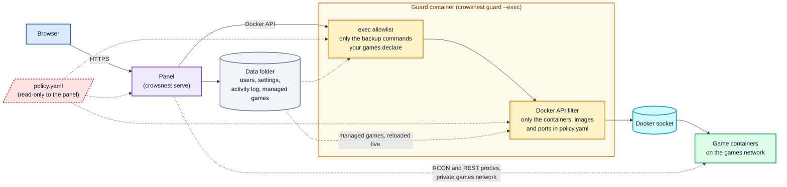
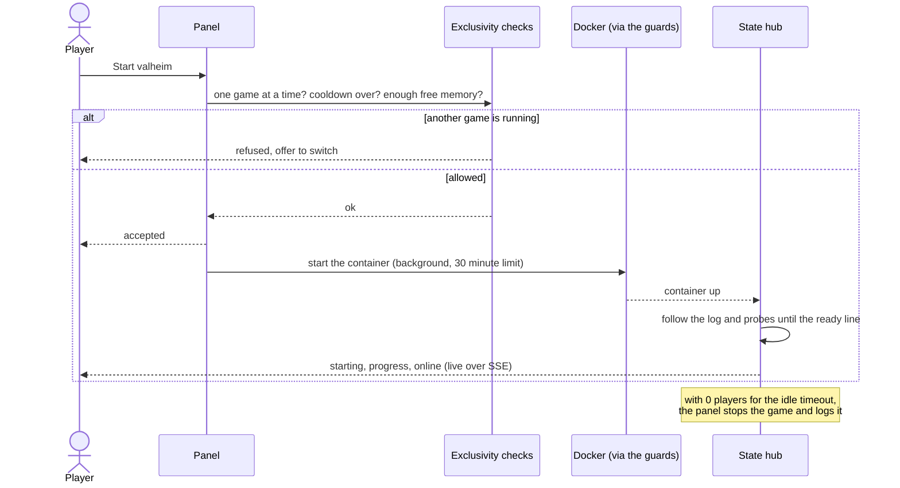
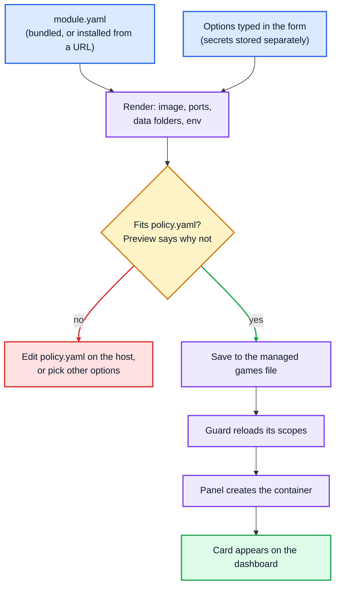

# CrowsNest

A self-hosted web dashboard for starting, stopping and watching game server containers on a home server. It shows
live status, logs, player counts and resource use, keeps one game running at a time by default, and stops a game on
its own when nobody has been on for a while.

## Why this exists

CrowsNest is a side project. It started with a Valheim server, then a Windrose server, then a Palworld server, all
for me and a friend we play with. I didn't want them running around the clock on my homelab machine, using memory
and CPU while nobody was playing.

So either of us can start a server when we want to play, play for as long as we like, and then stop it, or let it
stop itself after a set time with nobody on. The resources come back.

It's built for that: a few friends sharing one box, not a hosting business. If that sounds like your setup, it may
be useful to you too. The licence is noncommercial (see [License](#license)).

## How it fits together

The panel never gets the raw Docker socket in the recommended setup. Every Docker call goes through a guard that
ships in the same binary, so a bug in the web app can't turn into control of the whole host. The guard is its own
container, and the panel is the only other one.



The panel can read the policy but can't change what the guard enforces. If someone gets into the panel, they can
still only do what `policy.yaml` allows.

### What happens when someone presses Start



Start returns as soon as the checks pass. The pull and create happen in the background, so a closed tab or a proxy
timeout doesn't kill an image download partway through.

### Adding a game from the dashboard

Games added from the Games page are described by a module (one YAML file) and checked against the policy before
anything is created.



## Status

I run this myself, with Valheim, Windrose and Palworld. The login, dashboard, start, stop and switch,
live logs, startup progress, player counts, idle and overnight auto-stop, Discord notifications, the Games page and
memory checks are built and have tests. The Docker guards have their own tests too.

What I haven't verified against real servers yet:

- the Windrose log lines that mark a graceful quit;
- Valheim player joins and leaves on a live server;
- a full Start then Switch between two real games.

The Minecraft, Source and Don't Starve Together modules were written and tested against sample logs, not against
servers I run. Treat them as a starting point. The quickstart stack hasn't been run end to end on a clean machine
either, though its config and policy are checked by a test. [`docs/implementation-plan.md`](docs/implementation-plan.md)
has the history and the open items, and [`roadmap.md`](roadmap.md) has what's next.

## Games

| Module | Game | Status and players come from |
|---|---|---|
| `valheim` | Valheim (`lloesche/valheim-server`) | the container log |
| `palworld` | Palworld (`thijsvanloef/palworld-server-docker`) | its REST API |
| `windrose` | Windrose (`indifferentbroccoli/windrose-server-docker`) | the container log; richer info if the optional Windrose+ integration is on |
| `minecraft` | Minecraft (`itzg/minecraft-server`) | the container log |
| `source` | TF2, CS2, L4D2 and other Source-engine games | RCON |
| `dontstarve` | Don't Starve Together | the container log |

Every game's setup is in [docs/modules.md](docs/modules.md). How players actually reach a server (Tailscale, invite
codes, and why an HTTP tunnel can't carry game traffic) is in [docs/connecting.md](docs/connecting.md).

### Adding your own game

A game is one `module.yaml` file and no code. [docs/writing-modules.md](docs/writing-modules.md) walks through
writing one, checking it with `crowsnest module check` against a captured log before you run the game, installing it
(by hand or from a URL, with the download pinned to a hash), and sharing it. CrowsNest doesn't need to know about
your module for it to work.

Community-style modules that are not bundled live in [fiddler110/crowsnest-modules](https://github.com/fiddler110/crowsnest-modules): one folder per module, each signed, with a README
that covers everything a module needs, scripts to check, sign and install them, and a template to start from. Its
signing key for `managed.trusted_keys` is in that README.

## Running it

Images are published to `ghcr.io/fiddler110/crowsnest` (`:latest`, `:X.Y.Z`, `:X.Y`, `:dev`), scanned, signed with
cosign and shipped with an SBOM ([publishing](docs/publishing.md)). You don't need a Go toolchain.

**The fastest start** is [`quickstart/`](quickstart/README.md): the panel plus the guard, with no games configured.
You add games from the web page. Then open `http://<host>:5000`, read the setup code from
`docker compose logs crowsnest` and create the first admin. `docker compose exec crowsnest crowsnest doctor` checks
Docker access, file permissions, the policy and a few safety settings, and tells you what to fix.

Prefer to define games by hand in `config.yaml` and a compose file, or to see how CrowsNest reaches Docker (the
guard, or a socket proxy)? That is [docs/setup.md](docs/setup.md).

## What it does

Each topic here is a short version; the page it links to has the detail.

### Day to day

- **One game at a time** by default. A second Start is refused and the dashboard offers to switch; raise
  `max_active_games` to allow more, and CrowsNest refuses a start that would not fit in the host's free memory.
- **Starting is asynchronous:** the pull and create run in the background, with a progress bar.
- **Idle and overnight auto-stop:** a game with nobody on for 15 minutes (configurable, per game too) is stopped; an
  optional overnight window stops empty servers. Settings are changed from the dashboard and apply at once.
- **Activity log and playtime**, crash-loop detection, optional Prometheus `/metrics`, a host health strip, an
  admin console for games that support one, and join details with copy buttons on each card.

Details: [docs/operating.md](docs/operating.md).

### Games from the dashboard

Admins add, edit, copy, disable and delete games from the **Games** page, inside the limits of `policy.yaml`.
A game can be **copied** (its settings, with secrets copied by the server and never shown), and extra modules can be
**installed from an https address** if a publisher you trust signed them: previewed, confirmed with your password,
pinned by hash, and updatable from the dashboard. Modules to try this with:
[fiddler110/crowsnest-modules](https://github.com/fiddler110/crowsnest-modules).

Details, including a step-by-step for pulling in a module: [docs/managing-games.md](docs/managing-games.md).

### Backups

A game whose module declares a backup gets **Back up now**, optional backups before every stop, and pruning. A shared
**backups folder** (for example an external drive) keeps one folder per game and is checked every minute: a missing
drive is caught rather than quietly filling the system disk. **Restore** is a button for Minecraft, Valheim,
Windrose and Palworld. An **offsite copy** sidecar (`quickstart/offsite/`, rclone) copies the folder to any cloud or
SFTP target without CrowsNest holding the credentials, and its status shows on the dashboard.

Details and the things to watch: [docs/backups.md](docs/backups.md).

### Accounts and security

Two roles (admin, player); sessions you can list and end per device; password sign-in, Google and any OpenID Connect
provider, with an optional authenticator app (TOTP); sealed storage for client secrets, game secrets and the session
key. Behind the panel, the guard limits Docker to the containers, images and ports the policy names.

Details: [docs/accounts.md](docs/accounts.md), the policy and guard in [docs/modules.md](docs/modules.md), and how
to report a problem in [SECURITY.md](SECURITY.md).

### HTTP API

Everything the dashboard does goes through `/api/*` (session cookie plus a CSRF token for changes), with one
`GET /api/events` stream instead of polling. The routes are listed in [docs/api.md](docs/api.md).

## Development

```bash
go build ./...
go vet ./...
go test -race ./...

# Run locally (needs a config.yaml, see config.yaml.example)
go run ./cmd/crowsnest serve
```

## License

[PolyForm Noncommercial 1.0.0](LICENSE). In plain words (the licence text is what counts):

- Free to self-host for yourself, your friends and family, a club or community, a school or a charity, and to
  change and share, as long as you keep the licence and the notice in [NOTICE](NOTICE).
- Not free for commercial use. A company or service that runs CrowsNest as part of a business, such as a game
  server hosting provider, needs a separate licence from me.
- Splitting the server bill with friends is fine. Running it as a paid service isn't.

This is a source-available licence, not an OSI-approved open source one.

CrowsNest isn't taking outside pull requests, and I can't promise support or a release schedule. You're welcome to
fork it under the licence above, and to write your own game modules and share them: see
[docs/writing-modules.md](docs/writing-modules.md). To report a security problem, see [SECURITY.md](SECURITY.md).
