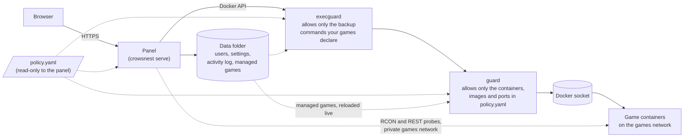
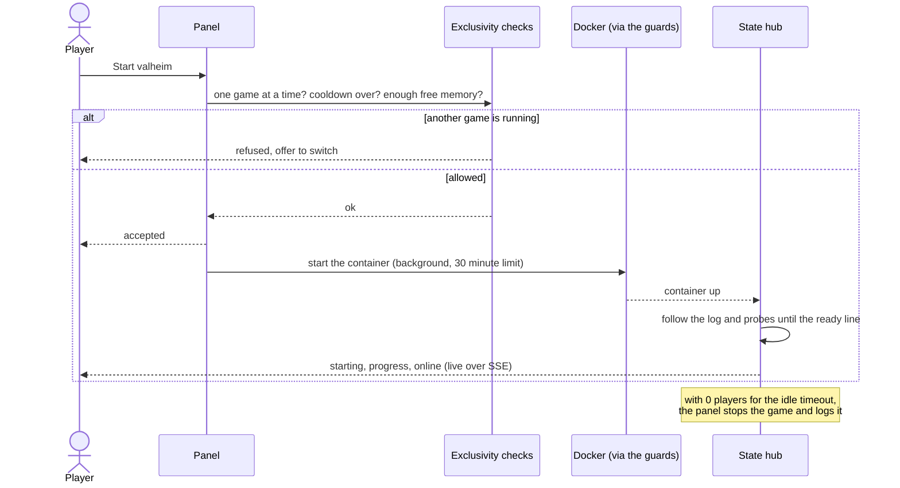
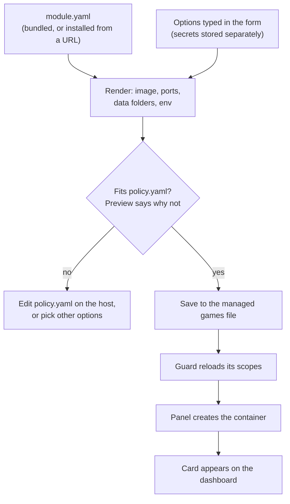

# CrowsNest

A self-hosted web dashboard for starting, stopping and watching game server containers on a home server. It shows
live status, logs, player counts and resource use, keeps one game running at a time by default, and stops a game on
its own when nobody has been on for a while.

## Why this exists

CrowsNest is a side project. It started with a Valheim server, then a Windrose server, then a Palworld server, all
for me and a friend we play with. I didn't want them running around the clock on my homelab machine, using memory
and CPU while nobody was playing.

So either of us can start a server when we want to play, play for as long as we like, and then stop it, or let it
stop itself after a set time with nobody on. The resources come back.

It's built for that: a few friends sharing one box, not a hosting business. If that sounds like your setup, it may
be useful to you too. The licence is noncommercial (see [License](#license)).

## How it fits together

The panel never gets the raw Docker socket in the recommended setup. Every Docker call goes through two small
filters that ship in the same binary, so a bug in the web app can't turn into control of the whole host.



The panel can read the policy but can't change what the guard enforces. If someone gets into the panel, they can
still only do what `policy.yaml` allows.

### What happens when someone presses Start



Start returns as soon as the checks pass. The pull and create happen in the background, so a closed tab or a proxy
timeout doesn't kill an image download partway through.

### Adding a game from the dashboard

Games added from the Games page are described by a module (one YAML file) and checked against the policy before
anything is created.



## Status

I run this myself, with Valheim, Windrose and Palworld. The login, dashboard, start, stop and switch,
live logs, startup progress, player counts, idle and overnight auto-stop, Discord notifications, the Games page and
memory checks are built and have tests. The Docker guards have their own tests too.

What I haven't verified against real servers yet:

- the Windrose log lines that mark a graceful quit;
- Valheim player joins and leaves on a live server;
- a full Start then Switch between two real games.

The Minecraft, Source and Don't Starve Together modules were written and tested against sample logs, not against
servers I run. Treat them as a starting point. The quickstart stack hasn't been run end to end on a clean machine
either, though its config and policy are checked by a test. [`docs/implementation-plan.md`](docs/implementation-plan.md)
has the history and the open items, and [`roadmap.md`](roadmap.md) has what's next.

## Games

| Module | Game | Status and players come from |
|---|---|---|
| `valheim` | Valheim (`lloesche/valheim-server`) | the container log |
| `palworld` | Palworld (`thijsvanloef/palworld-server-docker`) | its REST API |
| `windrose` | Windrose (`indifferentbroccoli/windrose-server-docker`) | the container log; richer info if the optional Windrose+ integration is on |
| `minecraft` | Minecraft (`itzg/minecraft-server`) | the container log |
| `source` | TF2, CS2, L4D2 and other Source-engine games | RCON |
| `dontstarve` | Don't Starve Together | the container log |

Every game's setup is in [docs/modules.md](docs/modules.md). How players actually reach a server (Tailscale, invite
codes, and why an HTTP tunnel can't carry game traffic) is in [docs/connecting.md](docs/connecting.md).

### Adding your own game

A game is one `module.yaml` file and no code. [docs/writing-modules.md](docs/writing-modules.md) walks through
writing one, checking it with `crowsnest module check` against a captured log before you run the game, installing it
(by hand or from a URL, with the download pinned to a hash), and sharing it. CrowsNest doesn't need to know about
your module for it to work.

## Running it

Images are published to `ghcr.io/fiddler110/crowsnest` (`:latest`, `:X.Y.Z`, `:X.Y`, `:dev`). Every push to `main`
passes the CI and security gate before a release is cut. Images are scanned, signed with cosign and shipped with an
SBOM; see [docs/publishing.md](docs/publishing.md). You don't need a Go toolchain.

**The fastest start** is [`quickstart/`](quickstart/README.md): the panel plus the two guards, with no games
configured. You add games from the web page. At any point,
`docker compose exec crowsnest crowsnest doctor` checks Docker access, file permissions, the policy and a few safety
settings, and tells you what to fix.

The steps below are the longer, hand-configured setup, where games are defined in `config.yaml` and a compose file.

1. Copy [`config.yaml.example`](config.yaml.example) to `config.yaml`, [`compose.yaml.example`](compose.yaml.example)
   to `compose.yaml` and [`.env.example`](.env.example) to `.env`, and edit them. `config.yaml` holds paths,
   timezone and integrations, `compose.yaml` holds volumes and ports, and `.env` holds secrets and host-specific
   values (it's git-ignored).

   CrowsNest runs `docker compose` against that same compose file from inside its own container (mounted at
   `/data/compose.yaml`, with `.env` next to it as `/data/.env`). So keep the top-level `name:`, use absolute
   `${USERDIR}/...` host paths in game services, and don't use `${VAR:?}` there: compose interpolates the whole
   file, so one missing variable for one game would block every game from starting. The header of
   `compose.yaml.example` explains each point.
2. Start only the controller: `docker compose up -d crowsnest`. It starts and stops the game containers itself, so
   you never run `--profile <game> up` by hand.
3. Open `http://<host>:5000`. With no users yet you get the first-run setup page. Read the setup code from
   `docker compose logs crowsnest` (it's also saved as `setup-token` next to the session secret), then choose an
   admin username and passphrase. The page closes once the first account exists, and there are no default
   credentials. If you'd rather use the command line,
   `docker compose exec crowsnest crowsnest set-password <username>` works too.

### One server at a time

The dashboard shows a card for every game, and any of them can be started or stopped from it. By default only one
game may run at once. Pressing Start on a second game is refused, and the dashboard offers to switch instead: stop
the running game, wait for it to go offline, then start the new one.

To allow more than one at a time, set `CROWSNEST_MAX_ACTIVE_GAMES` in `.env` or `server.max_active_games` in
`config.yaml` (the environment variable wins). When the limit is reached, Start still offers to switch away from
the first running game.

Palworld has a 30 second pause between a stop and the next start, because bringing it back up within seconds
crashed the server.

### Memory

Before a start, CrowsNest compares what the game needs with the host's available memory, minus a reserve
(`server.memory_reserve_mb`, 1024 by default, negative turns the check off). A game's need is its measured peak once
it has run, and the module's `runtime.ram` figure before that (an option on the game can override it). If it
doesn't fit, the start is refused with a message that says so. If the need or the host's memory isn't known, the
start is allowed.

With the default of one game at a time this rarely matters. It starts to matter once you raise
`max_active_games`.

### Starting is asynchronous

Start (and the start half of Switch) returns as soon as the limit, cooldown and memory checks pass. The
`docker compose up` itself, which includes pulling a multi-GB image the first time, runs in the background with a
30 minute limit. While it runs the game shows as **starting**, counts toward the limit, and its progress bar reads
"Pulling image / creating container" until the container exists. A failed start shows up as a toast on the
dashboard and as an `exclusivity: start ... failed` line in the log. Stop cancels a start that's still running.

With a compose file configured, Start always runs `compose up -d`, so edits to the compose file or `.env` take
effect on the next start (compose recreates the container). Behind a Docker API proxy that denies container delete
and rename, that recreate fails. Run `docker rm <game>` on the host, then Start again.

### Automatic shutdown and settings

By default a game with zero players for 15 minutes is stopped. It stays stopped until someone starts it again. A
game whose player count can't be read is never stopped automatically. An optional overnight window
(`night_shutdown`) stops empty servers during set hours.

Any signed-in user can change these from **Settings** on the dashboard, and the change applies immediately:

| Setting | Meaning |
|---|---|
| Stop a server when nobody is on it / minutes | the idle auto-stop and its timeout (1 to 1440 minutes) |
| Stop empty servers overnight / from / until | the overnight window, in `server.tz` hours |
| Servers allowed at once | how many games may run together |
| Update on start | run `docker compose pull` for the game each time it starts, so a restart picks up new server versions (a failed pull is logged and the old image is used) |

`config.yaml` holds the defaults. Whatever is saved from the dashboard is written to `server.settings_file`
(default `/app/data/settings.json`) and takes precedence from then on. Mount a directory there so it survives
container recreation (`${USERDIR}/crowsnest/config:/app/data` in `compose.yaml.example`; it must be writable by uid
1000). Delete the file to go back to the `config.yaml` values.

### Users and roles

There are two roles. An **admin** can do everything. A **player** can start, stop and switch games and see status,
players, stats and activity, but can't open Settings or the Games page, read container logs, use the console or
touch backups.

Admins manage users on the **Users** tab in Settings. From the command line,
`docker compose exec crowsnest crowsnest set-role <user> <admin|player>` does the same. A password account with no
role is an admin, so accounts from before roles existed behave as they did. A Google sign-in user with no role is a
player, so promote yourself with `crowsnest set-role <you> admin` before relying on Google sign-in (CrowsNest logs a
warning at startup when no user resolves to admin). Role changes apply within seconds, and a demotion applies on the
user's very next request.

### Activity log, playtime and host health

Everything notable is appended to `server.history_file` (default `/app/data/events.jsonl`, one JSON object per
line): who started, stopped or switched a game, automatic stops, failed starts, settings changes, backups, and
players joining and leaving. The dashboard's logbook shows the latest entries and the total time each player has
spent in each game. That comes from join and leave events, so it only covers games whose player names CrowsNest can
read. Entries older than `server.history_retention_days` (default 180) are pruned. Keep the file on the same
persistent mount as the settings file.

A strip under the fleet banner shows host memory, load and free disk space for the paths in
`server.host_disk_paths`, and turns red when a disk is under 10% free or memory is nearly full. Mount the disk your
game data and images live on (read-only is fine) and list its path to watch it.

### Backups

A game with a `backup:` block in `config.yaml` (or in its module) gets a Backups panel for admins, with a "Back up
now" button and the list of backup files. Backups run inside the game's container with `docker exec`, so they use
whatever the image provides (the Palworld example in `config.yaml.example` shows one).

`exec` needs the Docker proxy to allow it, and a generic proxy can't limit which commands run. That's what the
bundled exec guard is for (`crowsnest execguard`, and the `execguard` service in `compose.yaml.example`). It allows
exactly the commands your config implies (each `backup.exec`, the `list_dir` listing, Windrose's readiness check),
refuses exec options such as `Privileged`, `User` and `Env`, and only lets `exec/<id>/start` through for ids it
approved itself. Restart it after changing `backup:` settings.

For the Docker API itself, `crowsnest guard` replaces the generic socket proxy. It's a scoped filter that lets
CrowsNest see and control only the containers named in `GUARD_SCOPES` (or the policy, for games added from the
dashboard).

With `before_stop: true` CrowsNest also takes a backup each time it stops that game on purpose, after the world is
saved, so an "update on start" pull always has a fresh backup behind it. A failed backup is logged and never stops
the game from stopping.

### Admin console

Admins get a Console tab on games that support it (Palworld today). It has two parts.

- **Fixed actions**, always available to admins: Players (names and user ids), Announce, Save world, Kick, Ban and
  Unban. They go through the game's REST API and CrowsNest validates the arguments. There is deliberately no
  shutdown action. Use Stop, which also saves and backs up.
- **A raw RCON box**, off by default. Set `rcon_addr` (for example `palworld:25575`, with `RCON_ENABLED=true` on the
  game) and an admin turns on "Allow the raw RCON console" in Settings. It then sends any command to the server, so
  only enable it if you're comfortable with every admin being able to do that. The RCON password is
  `rcon_password_env`, defaulting to the REST API password.

Players never see the console, and the API refuses them. Every command, and any attempt on the raw console while
it's off, goes to the audit log and the activity feed.

### Sessions

Sessions are stateless signed cookies, valid for 3 hours after login. There's no "remember me", you log in again
once it expires. Because there's no server-side session store, you can't revoke one device. You can revoke all of a
user's sessions with `docker compose exec crowsnest crowsnest revoke-sessions <username>`. It edits the users file,
which a running CrowsNest watches, so it applies within a few seconds (as does `set-password`). It works for Google
users too, even though they have no password entry.

To remove someone entirely, take them off the Google allowlist (restart to apply) or delete their password entry
(applies within seconds). A session only stays valid while its username still has a way to sign in. Rotating or
deleting the session-secret file logs everyone out at once.

### Signing in with Google

CrowsNest can do "Sign in with Google" itself (OpenID Connect, server side) with its own allowlist, so it doesn't
need a separate auth proxy and a Google account only gets in if you listed it.

1. In Google Cloud Console, go to APIs & Services, then Credentials, and create an OAuth client ID of type **Web
   application** with the authorized redirect URI `https://<your host>/auth/google/callback`. On the consent
   screen, `openid` and `email` are the only scopes CrowsNest asks for.
2. In `.env`, set `CROWSNEST_GOOGLE_CLIENT_ID`, `CROWSNEST_GOOGLE_CLIENT_SECRET` and the allowlist, for example
   `CROWSNEST_GOOGLE_USERS=alice=alice@gmail.com,bob=bob@example.org`. The name before each `=` is the CrowsNest
   username that account signs in as (in the audit log, and for `revoke-sessions`).
3. In `config.yaml`, add `auth.google.redirect_url` with the same URL, and `auth.password_login: false` if Google
   should be the only way in. An https redirect URL also needs `server.secure_cookies: true`.

CrowsNest refuses to start if a value is missing or malformed. Addresses must be plain ASCII and match the Google
account's exactly (case aside), so `j.doe@gmail.com` and `jdoe@gmail.com` are different entries.

The flow uses a signed 10 minute state cookie (state, nonce and PKCE) and exchanges the code with Google's token
endpoint directly over TLS. Once signed in, it's the same 3 hour session as a password login. Requests to Google
need outbound HTTPS from the container.

### Showing join details on the cards

A game's card can show where to connect and what to type, each with a copy button. In `config.yaml`:

```yaml
games:
  - id: palworld
    connect_address: "10.0.0.2:8211"
    connect_note: "Turn on Tailscale first"
    connect_secrets:
      - {label: Join password, env: PALWORLD_SERVER_PASSWORD}
```

`connect_secrets` values come from environment variables, so they stay in `.env`. Pass each one to the crowsnest
service in `compose.yaml`. An unset or empty variable is left out (and logged by name). Everything here is shown to
every signed-in user, so list only what any player should see, such as a join password or invite code, and never
the admin or REST password. Modules can declare the same thing with `connect:`.

### Docker socket access

`compose.yaml.example` mounts `/var/run/docker.sock` straight into the crowsnest container by default. That's the
simplest setup, but anything that runs arbitrary code inside the container then has root-equivalent control of the
host. I'd only use it on a machine where that's acceptable.

The better options, in order:

- The [quickstart](quickstart/README.md) stack, which puts `execguard` and `guard` in front of the socket and uses
  the policy file. This is what I'd recommend.
- The commented-out [docker-socket-proxy](https://github.com/Tecnativa/docker-socket-proxy) service in
  `compose.yaml.example`, allowing only the API calls CrowsNest makes. Point `server.docker_host` at it
  (`tcp://dockerproxy:2375`) instead of mounting the socket. The comments in both example files cover the swap.

If the panel is exposed to the internet, put it behind HTTPS, set `server.secure_cookies: true`, and list your
reverse proxy in `server.trusted_proxies` so the sign-in rate limit counts real visitors. `crowsnest doctor` checks
these.

## HTTP API

All `/api/*` routes need a session cookie (log in at `/login` first). State-changing routes also need the session's
CSRF token. The dashboard itself uses `GET /api/events`, one stream of state changes, instead of polling.

| Method | Path | Description |
|--------|------|-------------|
| `GET` | `/api/games` | All games and their current status |
| `GET` | `/api/events` | SSE stream of state changes (a few streams per user) |
| `GET` | `/api/games/{id}/status` | One game's status: `online`, `starting`, `offline` or `unknown` |
| `GET` | `/api/games/{id}/startup-progress` | SSE stream of startup milestones |
| `GET` | `/api/games/{id}/stats` | CPU, memory and (if available) GPU use |
| `GET` | `/api/games/{id}/players` | Player count and names, where available |
| `GET` | `/api/games/{id}/info` | Per-game info panel, where the module provides one |
| `POST` | `/api/games/{id}/start` | Start the game's container |
| `POST` | `/api/games/{id}/switch` | Stop whichever game is running, then start this one |
| `POST` | `/api/games/{id}/stop` | Stop the game (accepted, runs in the background; status shows `stopping`) |
| `GET` | `/api/activity` | Recent activity and playtime per player (`?limit=`, `?game=`) |
| `GET` | `/api/host` | Host memory, load and disk space |
| `GET` | `/api/health` | Whether CrowsNest can reach Docker |
| `GET` | `/api/games/{id}/logs` | SSE stream of `docker logs -f` (**admin only**) |
| `GET`/`PUT` | `/api/settings` | Runtime settings (**admin only**) |
| `GET` | `/api/games/{id}/console` | Console actions and raw-console state (**admin only**) |
| `POST` | `/api/games/{id}/console/action` | Run a fixed console action (**admin only**) |
| `POST` | `/api/games/{id}/console/raw` | Send a raw RCON command, refused unless enabled in Settings (**admin only**) |
| `GET` | `/api/games/{id}/backups` | Backup files (**admin only**) |
| `POST` | `/api/games/{id}/backup` | Start a backup in the background (**admin only**) |
| `GET`/`POST`/`PUT`/`DELETE` | `/api/users`, `/api/users/{name}` | Manage users (**admin only**) |
| various | `/api/managed/...` | The Games page: modules, policy, preview, enable, edit, refresh, roll back and disable games (**admin only**) |

## Development

```bash
go build ./...
go vet ./...
go test -race ./...

# Run locally (needs a config.yaml, see config.yaml.example)
go run ./cmd/crowsnest serve
```

## License

[PolyForm Noncommercial 1.0.0](LICENSE). In plain words (the licence text is what counts):

- Free to self-host for yourself, your friends and family, a club or community, a school or a charity, and to
  change and share, as long as you keep the licence and the notice in [NOTICE](NOTICE).
- Not free for commercial use. A company or service that runs CrowsNest as part of a business, such as a game
  server hosting provider, needs a separate licence from me.
- Splitting the server bill with friends is fine. Running it as a paid service isn't.

This is a source-available licence, not an OSI-approved open source one.

CrowsNest isn't taking outside pull requests, and I can't promise support or a release schedule. You're welcome to
fork it under the licence above, and to write your own game modules and share them: see
[docs/writing-modules.md](docs/writing-modules.md). To report a security problem, see [SECURITY.md](SECURITY.md).
